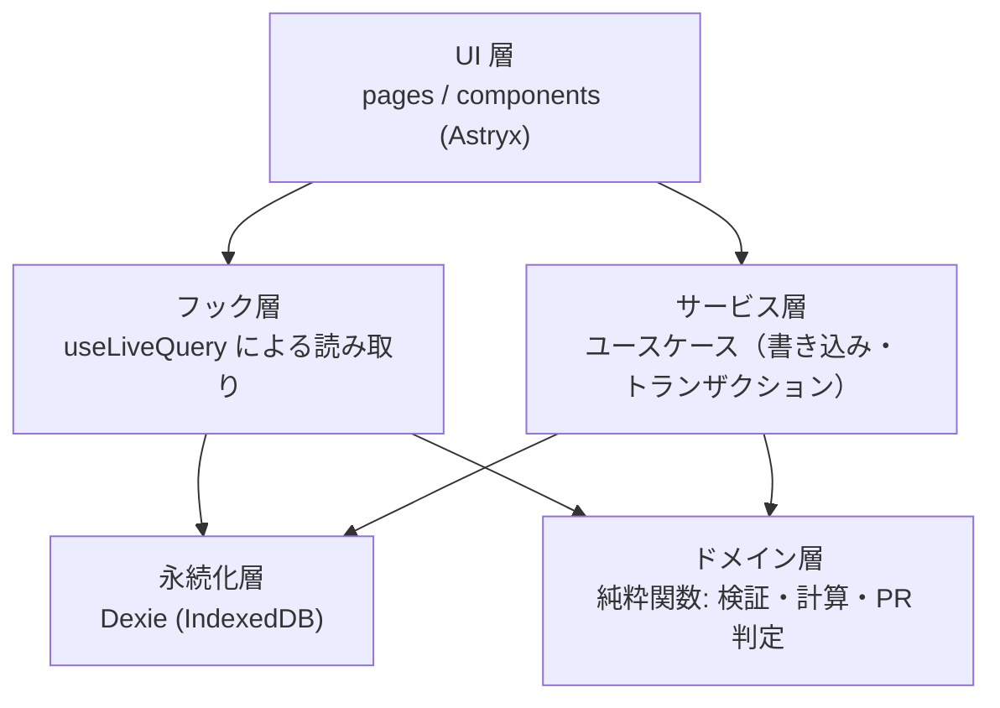
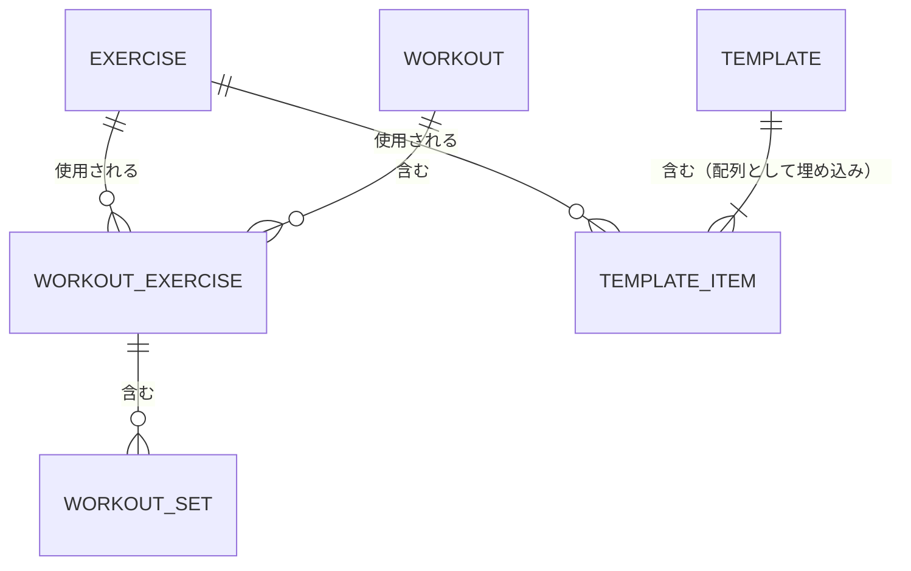
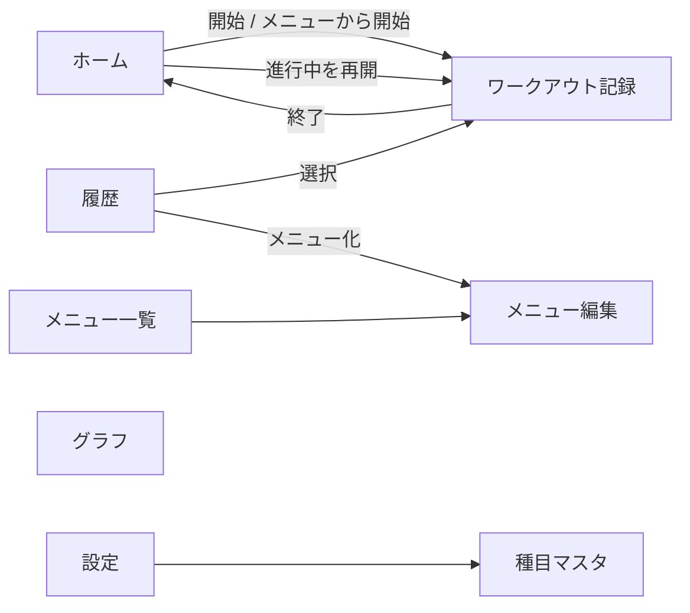

# 設計書: 筋トレ管理アプリ (Workout Tracker)

- ステータス: 承認済み（2026-11-17）
- 作成日: 2026-11-17
- 対応する要件: [requirements.md](./requirements.md)（2026-11-17 承認済み）

本書の各設計項目には、満たす要件 ID（`REQ-x.x` / `NFR-x`）を併記する。

---

## 1. 技術スタック

| 役割 | 採用 | 選定理由 |
| --- | --- | --- |
| 言語 | TypeScript 5 (strict) | 型でデータモデルと検証ロジックの誤りを防ぐ |
| UI フレームワーク | React 19 | Astryx の peer 依存が `react >= 19` |
| ビルド | Vite | 高速な開発サーバー。Astryx はビルド済み配布のため追加プラグイン不要 |
| UI コンポーネント | Astryx (`@astryxdesign/core` + `@astryxdesign/theme-neutral`) | アクセシブルなコンポーネント群、ダークモード、`ja-JP` ロケールを備える |
| ルーティング | React Router（Hash ルーター） | 静的ホスティングでもサーバー設定なしで動作する |
| データ保存 | Dexie.js 4 + `dexie-react-hooks` | IndexedDB をトランザクション付きで扱え、`useLiveQuery` で保存内容を画面に自動反映できる |
| 入力・インポート検証 | Zod | 実行時のスキーマ検証と TypeScript 型を一元化する |
| グラフ | Recharts | 安定版。Astryx の charts は canary のみのため不採用 |
| PWA | vite-plugin-pwa | Service Worker による全アセットのプリキャッシュ |
| テスト | Vitest + Testing Library + fake-indexeddb | Vite と設定を共有でき、IndexedDB をメモリ上で再現できる |

### 1.1 動作・開発環境の前提

- **Node.js 22 LTS 以上**（Astryx CLI が `>= 22.13` を要求）。現在の開発環境は Node 18.20.4 のため、**実装開始前にアップグレードが必要**。
- パッケージのバージョンは `package-lock.json` で固定する。Astryx はベータ版（調査時点 0.7.16）のため、更新は意図的に行う。

---

## 2. アーキテクチャ

### 2.1 レイヤー構成



| 層 | 責務 | 依存してよい先 |
| --- | --- | --- |
| UI | 表示・入力・画面遷移。ビジネスルールを持たない | フック・サービス・ドメイン（型と表示用関数） |
| フック | DB の読み取りと、ドメイン関数による集計結果の提供 | 永続化・ドメイン |
| サービス | 1 操作 = 1 関数。検証 → トランザクション内で書き込み | 永続化・ドメイン |
| ドメイン | 副作用のない純粋関数。**テストの主対象**（NFR-12） | なし |
| 永続化 | Dexie のスキーマ定義・初期データ投入 | なし |

### 2.2 ディレクトリ構成

```
src/
├── app/            # App.tsx, ルーティング, Theme などのプロバイダー
├── domain/         # 純粋関数と型（React / Dexie に依存しない）
│   ├── types.ts
│   ├── validation.ts     # セット値・種目名・メニュー名・日付の検証
│   ├── metrics.ts        # ボリューム・推定 1RM・ワークアウト別集計
│   ├── pr.ts             # 自己ベスト判定
│   ├── setDefaults.ts    # セット入力の初期値決定
│   ├── period.ts         # グラフ期間の計算
│   ├── backupSchema.ts   # JSON バックアップの Zod スキーマ
│   └── csv.ts            # CSV 生成
├── db/             # Dexie スキーマ, 初期種目データ
├── services/       # workoutService, exerciseService, templateService, backupService
├── hooks/          # useWorkout, useHistory, useExerciseProgress など
└── ui/
    ├── pages/
    └── components/
```

---

## 3. データモデル

### 3.1 エンティティ関連



### 3.2 型定義

```ts
type ID = string;           // crypto.randomUUID()
type ISODate = string;      // 'YYYY-MM-DD'（端末のローカル日付）
type ISODateTime = string;  // new Date().toISOString()

type BodyPart = 'chest' | 'back' | 'legs' | 'shoulders' | 'arms' | 'abs' | 'other';

interface Exercise {
  id: ID;
  name: string;            // 表示名（前後の空白を除去して保存）
  nameKey: string;         // 重複判定用: trim + NFKC 正規化 + 小文字化（REQ-2.4）
  bodyPart: BodyPart;
  archived: boolean;       // REQ-2.8〜2.11
  createdAt: ISODateTime;
  updatedAt: ISODateTime;
}

interface Workout {
  id: ID;
  date: ISODate;                         // REQ-1.16
  status: 'in_progress' | 'completed';   // REQ-1.20
  memo: string;                          // 最大 500 文字（REQ-1.15）
  createdAt: ISODateTime;                // 同日内の並び順に使用（REQ-3.1）
  completedAt: ISODateTime | null;
  updatedAt: ISODateTime;
}

interface WorkoutExercise {
  id: ID;
  workoutId: ID;
  exerciseId: ID;
  order: number;                 // ワークアウト内の表示順
  targetSets: number | null;     // メニューから開始した場合のみ（REQ-4.10）
}

interface WorkoutSet {
  id: ID;
  workoutExerciseId: ID;
  workoutId: ID;                 // 非正規化: ワークアウト単位の集計・削除用
  exerciseId: ID;                // 非正規化: 種目単位のグラフ・PR 計算用
  order: number;                 // 種目内の順序（1 始まりのセット番号の元）
  weightTenthKg: number;         // 重量 × 10 の整数（例: 62.5kg → 625）
  reps: number;
  createdAt: ISODateTime;
}

interface Template {
  id: ID;
  name: string;                  // 1〜50 文字（REQ-4.2）
  items: { exerciseId: ID; targetSets: number | null }[];  // 配列順 = 種目順（REQ-4.1）
  createdAt: ISODateTime;
  updatedAt: ISODateTime;
}
```

**設計判断:**

- **重量は 0.1kg 単位の整数で保存する。** 浮動小数の誤差（`0.1 + 0.2` 問題）を避け、ボリューム合計や PR 比較を正確にするため。表示・入力時のみ kg に変換する。
- **`WorkoutSet` に `workoutId` と `exerciseId` を重複して持たせる。** グラフや PR 計算で「ある種目の全セット」をインデックスから直接取得するため（NFR-5）。この値は書き込みをサービス層だけに限定して整合性を保つ。
- **メニューの種目は `Template.items` 配列に埋め込む。** 単独で参照されることがなく、並べ替えが配列の更新だけで済むため。

### 3.3 IndexedDB スキーマ（Dexie）

```ts
db.version(1).stores({
  exercises:        'id, &nameKey, bodyPart',
  workouts:         'id, date, status, createdAt',
  workoutExercises: 'id, workoutId, exerciseId',
  sets:             'id, workoutExerciseId, workoutId, exerciseId',
  templates:        'id',
});
```

- `&nameKey` は一意インデックスとし、種目名の重複を DB レベルでも防ぐ（REQ-2.4）。
- IndexedDB は boolean をインデックスにできないため、`archived` は取得後にメモリ上で絞り込む（種目数は数十〜数百件のため問題ない）。
- 将来スキーマを変更する場合は `db.version(2).upgrade(...)` で移行する。

### 3.4 初期データ（REQ-2.1）

Dexie の `populate` イベント（DB 新規作成時に 1 回だけ実行される）で、以下を投入する。

| 部位 | 初期種目 |
| --- | --- |
| 胸 | ベンチプレス / ダンベルプレス / インクラインベンチプレス / ダンベルフライ |
| 背中 | デッドリフト / 懸垂 / ラットプルダウン / ベントオーバーロウ |
| 脚 | スクワット / レッグプレス / ルーマニアンデッドリフト / レッグカール |
| 肩 | ショルダープレス / サイドレイズ / リアレイズ |
| 腕 | バーベルカール / ダンベルカール / トライセプスエクステンション |
| 腹 | クランチ / プランク / レッグレイズ |
| その他 | （なし。ユーザーが追加する） |

※「その他」は 3 種目以上の対象外とする（REQ-2.1 の「各部位」は胸〜腹の 6 部位と解釈）。（2026-11-17 レビューで決定）

---

## 4. ドメインロジック

すべて `src/domain/` の純粋関数として実装し、単体テストで検証する。

### 4.1 入力検証（`validation.ts`）

| 関数 | ルール | 要件 |
| --- | --- | --- |
| `validateSet(weightKg, reps)` | 重量: 数値・0〜999.9・小数第 1 位まで / 回数: 整数・1〜999。未入力はエラー | REQ-1.9, 1.11 |
| `validateExerciseName(name, existing, selfId?)`（`existing` は `{ id, nameKey }` の配列） | trim 後 1〜50 文字 / `nameKey` が他の種目と重複しない（編集時は自分自身を除く） | REQ-2.3, 2.4, 2.6 |
| `validateTemplate(name, items)` | trim 後 1〜50 文字 / items が 1 件以上 / targetSets は null または 1〜20 の整数 | REQ-4.2, 4.3, 4.4 |
| `validateWorkoutDate(date, today)` | `date <= today` | REQ-1.17 |
| `MEMO_MAX_LENGTH = 500` | 入力欄の `maxLength` として使用 | REQ-1.15 |

戻り値は `{ ok: true, value } | { ok: false, errors: Record<field, message> }` とし、UI は `errors` を各入力欄の近くに表示する。

### 4.2 指標計算（`metrics.ts`）

```ts
volume(sets)          = Σ (weightKg × reps)
estimated1RM(set)     = w × (1 + r / 30)          // Epley 式（要件の用語定義どおり。r=1 でも式を適用）
estimated1RMUnits(set) = 重量×10 × (30 + r)        // 1/300kg 単位の整数。PR 判定で「厳密に上回る」を誤差なく比較するために使う
summarizeWorkout(sets) → { setCount, totalVolume }                      // REQ-3.2
seriesByWorkout(exerciseId, sets, workouts)
                      → { date, maxWeight, maxE1RM, volume }[]          // REQ-3.8〜3.10
```

- 表示時は小数第 1 位に丸める。内部計算は丸めない。
- 自重種目（重量 0kg）はボリューム・推定 1RM ともに 0 になる（決定事項どおりの仕様）。

### 4.3 自己ベスト判定（`pr.ts`）— REQ-3.13, 3.14

1. 対象種目の全セットを **時系列順**（ワークアウトの `date` → `createdAt` → セットの `order`）に並べる。
2. 先頭から走査し、これまでの最大重量・最大推定 1RM を保持する。
3. 現在のセットの重量または推定 1RM が、**それまでの最大値を厳密に上回る**場合、そのセットを PR とする。
4. 結果は `Map<setId, { weight: boolean; e1rm: boolean }>` として返す。

**設計判断:**

- **PR は保存せず、表示のたびに計算する。** セットの追加・編集・削除や日付変更で過去の PR が変わり得るため、保存すると更新漏れが起こる。計算で求めれば、REQ-3.14（再計算）は自動的に満たされる。1 種目あたり数百〜数千セットなので、計算コストは小さい。
- **その種目の最初のセットは PR としない。** 比較対象がなく、記録を始めた直後に全種目が PR になると印の意味が薄れるため。（2026-11-17 レビューで決定）
- 0kg のセットは重量・推定 1RM ともに 0 のため、PR にならない。

### 4.4 セット入力の初期値（`setDefaults.ts`）— REQ-1.6, 1.7

```
currentSets（このワークアウト内の同種目セット）が 1 件以上 → 最後のセットの重量・回数
そうでなく、過去のワークアウトに同種目の記録がある       → 直近ワークアウトの最初のセットの重量・回数
どちらもない                                              → 空欄
```

関数は `getSetDefaults(exerciseId, current, sets, workouts)`（初期値）と `findPreviousRecord(...)`（REQ-1.5 の前回記録）の 2 つ。時系列の比較（日付 → 作成日時 → ID）は `domain/chronology.ts` に共通化し、指標計算・PR 判定でも使う。「直近」は時系列順で現在のワークアウトより前のもののうち、その種目を行った最後のワークアウトとする。過去の日付に変更したワークアウトを編集する場合も、そのワークアウトより前のものを参照する。REQ-1.5 の「前回記録」の表示にも同じ関数を使う。

### 4.5 グラフ期間（`period.ts`）— REQ-3.11

| 選択肢 | 開始日 |
| --- | --- |
| 1 か月 | 当日の 1 か月前の同日（存在しなければ月末） |
| 3 か月 | 当日の 3 か月前の同日 |
| 1 年 | 当日の 1 年前の同日 |
| 全期間 | 下限なし |

`開始日 <= date <= 当日` のワークアウトを対象とする。

### 4.6 日付の扱い

- ワークアウトの `date` は端末のローカルタイムゾーンでの日付文字列とする。UTC に変換しない（深夜に日付がずれるのを防ぐため）。
- 「当日」は `today()` 関数で取得し、テストでは引数として注入する。

---

## 5. サービス層（書き込み処理）

各関数は第 1 引数に DB（`WorkoutDatabase`）、最後の引数に省略可能な依存 `ServiceDeps`（ID 生成と現在時刻。テストで差し替える）を取る。検証に失敗した場合は `{ ok: false, errors }` を返し、DB のエラーは握りつぶさず投げる（UI 側の共通処理で通知する。5.5 節）。

各関数は「検証 → Dexie トランザクション内で読み書き」の順に処理する。トランザクション内で例外が起きた場合、Dexie が自動でロールバックする。

### 5.1 ワークアウト（`workoutService.ts`）

| 関数 | 処理 | 要件 |
| --- | --- | --- |
| `startWorkout(templateId?)` | トランザクション内で `status='in_progress'` のワークアウトを探す。あればその ID を返す（新規作成しない）。なければ当日の日付で作成し、メニュー指定時は有効な種目を順に追加する。アーカイブ済みで除外した種目名も返す | REQ-1.1, 1.24, 4.8, 4.9 |
| `finishWorkout(id)` | セット数が 0 なら `{ needsDiscardConfirm: true }` を返す。1 以上なら `status='completed'`, `completedAt` を設定 | REQ-1.20, 1.21 |
| `discardWorkout(id)` | ワークアウトと関連する WorkoutExercise・Set を削除 | REQ-1.22, 3.5 |
| `addExercise(workoutId, exerciseId)` | 末尾の `order` で追加 | REQ-1.4 |
| `removeExercise(workoutExerciseId)` | WorkoutExercise と配下のセットを削除 | REQ-1.13 |
| `addSet / updateSet / deleteSet` | `validateSet` で検証し、失敗時はエラーを返して書き込まない | REQ-1.8〜1.12 |
| `updateMemo(id, memo)` | 500 文字に切り詰めて保存 | REQ-1.14, 1.15 |
| `updateDate(id, date)` | `validateWorkoutDate` で検証して保存 | REQ-1.16, 1.17 |

### 5.2 種目（`exerciseService.ts`）

| 関数 | 処理 | 要件 |
| --- | --- | --- |
| `createExercise / updateExercise` | `validateExerciseName` で検証。一意インデックス違反（`ConstraintError`）も重複エラーとして扱う | REQ-2.2〜2.6 |
| `deleteExercise(id)` | トランザクション内で WorkoutExercise・Template の使用有無を確認し、使用中ならアーカイブ、未使用なら削除。結果（`'deleted' \| 'archived'`）を返して UI で伝える | REQ-2.7, 2.8 |
| `restoreExercise(id)` | `archived=false` に更新 | REQ-2.11 |

### 5.3 メニュー（`templateService.ts`）

| 関数 | 処理 | 要件 |
| --- | --- | --- |
| `createTemplate / updateTemplate` | `validateTemplate` で検証して保存 | REQ-4.1〜4.6 |
| `deleteTemplate(id)` | 削除 | REQ-4.7 |
| `draftFromWorkout(workoutId)` | 種目順と各種目のセット数を `targetSets` とした下書きを返す（保存はしない）。セット数が 20 を超える場合は 20 にする | REQ-4.11 |

### 5.4 バックアップ（`backupService.ts`）

**JSON エクスポート（REQ-5.1, 5.2）**

```json
{
  "format": "workout-tracker-backup",
  "version": 1,
  "exportedAt": "2026-11-17T10:00:00.000Z",
  "data": { "exercises": [], "workouts": [], "workoutExercises": [], "sets": [], "templates": [] }
}
```

ファイル名は `workout-tracker-YYYYMMDD.json` とする。

**JSON インポート（REQ-5.3〜5.6）**

1. ファイルを読み込み、`JSON.parse` する。失敗したらエラーを表示する。
2. Zod スキーマで `format`・`version`・全レコードの型と値の範囲を検証する。
3. 参照の整合性を検証する（存在しない `exerciseId` や `workoutId` への参照がないか、`nameKey` が重複していないか、進行中のワークアウトが 2 件以上ないか）。
4. 1〜3 がすべて成功した後で、全テーブルを対象とした 1 つの読み書きトランザクション内で、全件削除 → 一括追加を行う。
5. 4 の途中で例外が起きた場合はトランザクションごとロールバックされ、既存データは元のまま残る（REQ-5.6）。

検証（1〜3）は確認ダイアログ（REQ-5.3）より**前**に行う。不正なファイルの場合、確認を求めずにエラーを表示する。

**CSV エクスポート（REQ-5.7）**

- 列: `日付,種目,部位,セット番号,重量,回数`。日付の古い順、同じワークアウト内は種目順・セット順に並べる。
- Excel で文字化けしないよう、UTF-8 BOM 付きで出力する。行の区切りは CRLF。重量は小数第 1 位まで（例: `60.0`）、セット番号は種目記録ごとに 1 から数える。
- `"`・`,`・改行を含む値は RFC 4180 に従ってエスケープする。
- 種目名が `=` `+` `-` `@` タブ CR のいずれかで始まる場合は、表計算ソフトで数式として実行されないよう先頭に `'` を付ける（インポートした他人のバックアップ経由で悪意のある名前が入る可能性への対策）。

### 5.5 保存失敗時の扱い（REQ-1.19）

- サービス関数が投げた例外は UI 側の共通ハンドラーで受け、Astryx の `Toast` で「保存できませんでした」と表示する。
- 容量超過（`QuotaExceededError`）の場合は、バックアップを促す文言を加える。
- 起動時に `navigator.storage.persist()` を呼び、ブラウザによるデータの自動削除を受けにくくする（NFR-7 の補強）。

---

## 6. 画面設計

### 6.1 画面一覧とルート

| ルート | 画面 | 主な要件 |
| --- | --- | --- |
| `#/` | ホーム（開始・メニュー一覧・進行中への導線） | REQ-1.1, 1.23, 1.24, 4.8 |
| `#/workouts/:id` | ワークアウト記録・編集 | REQ-1.x, 1.25, 3.3, 3.13 |
| `#/history` | 履歴（一覧 / カレンダー切り替え） | REQ-3.1〜3.7 |
| `#/progress` | グラフ | REQ-3.8〜3.12 |
| `#/templates` | メニュー一覧 | REQ-4.7 |
| `#/templates/new`, `#/templates/:id` | メニュー作成・編集 | REQ-4.1〜4.6, 4.11 |
| `#/exercises` | 種目マスタ管理 | REQ-2.x |
| `#/settings` | データ管理（エクスポート・インポート） | REQ-5.x |

### 6.2 画面遷移



- 幅 768px 未満は、画面下部に固定した**自作の下部タブ**（`ui/components/BottomTabs`）を表示する: ホーム / 履歴 / グラフ / メニュー / 設定。
- 幅 768px 以上では `AppShell` と `SideNav` を使ったサイドナビゲーションに切り替える（NFR-2）。
- **設計判断（2026-11-18 変更）:** Astryx の `MobileNav` はハンバーガーボタンで開く引き出しメニューで、下部タブの部品は Astryx にない。片手で 1 タップで移動できるよう、下部タブのみ自作する。`AppShell` には `mobileNav={{ hasToggle: false }}` を指定し、色は Astryx のテーマトークンを使う。
- **起動時**、進行中のワークアウトがあれば `#/workouts/:id` にリダイレクトする（REQ-1.23）。

### 6.3 ワークアウト記録画面（中心となる画面）

```
┌──────────────────────────────┐
│ 2026-11-17 [日付変更]   進行中 │
├──────────────────────────────┤
│ ベンチプレス            [⋮]   │
│  前回: 60kg×10, 60kg×8, 60kg×8 │ ← REQ-1.5
│  1  60.0kg × 10  🏆PR    [✎]   │ ← REQ-3.13
│  2  60.0kg ×  8          [✎]   │
│  ┌──────┐ ┌────┐ ┌───────┐ │
│  │ 60.0 kg │ │  8 回│ │+ セット│ │ ← 初期値入り。1 タップで追加
│  └──────┘ └────┘ └───────┘ │   (REQ-1.6, NFR-4)
│  2 / 3 セット                  │ ← 目標セット数 (REQ-4.10)
├──────────────────────────────┤
│ [+ 種目を追加]                 │ → BottomSheet で部位別選択
│ メモ: ________________ 0/500   │
├──────────────────────────────┤
│        [ ワークアウト終了 ]     │
└──────────────────────────────┘
```

- 重量・回数の入力欄には、それぞれ −/+ ボタン（重量 ±1kg、回数 ±1）を付け、片手で調整しやすくする（NFR-3）。刻み幅は全種目共通の固定値とする。
- セットの編集は `BottomSheet` で開く。
- 状態が「完了」のときも同じ画面で編集できる。その場合「ワークアウト終了」ボタンは表示しない（REQ-1.25）。

### 6.4 Astryx コンポーネントの割り当て

| 用途 | Astryx コンポーネント | 要件 |
| --- | --- | --- |
| アプリ枠・ナビゲーション | `AppShell`, `SideNav`, `TopNav`（スマホの下部タブは自作） | NFR-2, NFR-3 |
| 重量・回数の入力 | `NumberInput` | REQ-1.8 |
| 種目名・メニュー名 | `TextInput`, `Field`, `FieldStatus`（エラー表示） | REQ-1.9, 2.3 |
| メモ | `TextArea`（`maxLength=500`） | REQ-1.14, 1.15 |
| 日付変更 | `DateInput` | REQ-1.16 |
| 部位・期間・一覧/カレンダーの切り替え | `SegmentedControl` | REQ-1.3, 3.11 |
| 部位の選択（種目編集） | `Selector` | REQ-2.2 |
| 種目の選択・セット編集 | `BottomSheet`, `List`, `Item` | REQ-1.2, 1.10 |
| 履歴カレンダー | `useCalendarDays` + `useCalendarNavigation`（日付マスは自作） | REQ-3.6 |
| 履歴一覧の項目 | `ClickableCard` | REQ-3.1, 3.2 |
| 削除・破棄・インポートの確認 | `AlertDialog` | REQ-3.4, 1.21, 5.3 |
| 保存失敗・処理結果の通知 | `Toast` | REQ-1.19, 2.8 |
| PR の印 | `Badge` | REQ-3.13 |
| 記録がない場合 | `EmptyState` | REQ-3.12 |
| インポートするファイルの選択 | `FileInput` | REQ-5.4 |
| 目標セットの進み具合 | `Text`（「2 / 3 セット」） | REQ-4.10 |
| メニューの種目並べ替え | `IconButton`（↑ / ↓） | REQ-4.5 |

**設計判断:**

- **並べ替えはドラッグではなく ↑↓ ボタンで行う。** Astryx の並べ替え機能は内部モジュール（`internal/reorder`）で公開 API ではない。ボタン操作はスマホでも誤操作が少なく、キーボードやスクリーンリーダーでも使える。
- **設計判断（2026-11-18 試作で確認）:** Astryx の `Calendar` には日付ごとに印を付ける機能がない。そのため、日付の計算と月の移動は Astryx の `useCalendarDays` / `useCalendarNavigation` を使い、日付マスの表示（● の印、タップ領域 44px 以上）は自作する。

### 6.5 テーマ・言語

```tsx
<Theme theme={neutralTheme} mode="system">   {/* OS 設定に追従（NFR-9） */}
  <App />
</Theme>
```

- CSS は `@astryxdesign/core/reset.css`・`astryx.css`・`@astryxdesign/theme-neutral/theme.css` を読み込む。
- Astryx 同梱の `ja-JP` ロケールを使用する（NFR-11）。
- グラフの線の色は Astryx のテーマのトークン（CSS カスタムプロパティ）を参照し、ライト / ダーク両方で読めるようにする（NFR-10）。

### 6.6 グラフ画面（REQ-3.8〜3.12）

- 上部に種目の選択（`Selector`）と期間の切り替え（`SegmentedControl`）を置く。
- その下に「最大重量」「推定 1RM」「ボリューム」の 3 つの折れ線グラフを縦に並べる（Recharts の `LineChart`）。横軸は日付、1 点 = 1 ワークアウト。
- 期間内に記録がなければ、3 つのグラフの代わりに `EmptyState` で「記録がありません」と表示する。

---

## 7. 非機能要件への対応

| ID | 対応 |
| --- | --- |
| NFR-1 | 主要 4 ブラウザで手動確認。Vite のビルドターゲットは各ブラウザの最新版とする |
| NFR-2 | モバイル優先のレイアウト。幅 768px を境にナビゲーションを切り替える。幅 360px で手動確認 |
| NFR-3 | 主要ボタンは Astryx の大きいサイズを使う。足りない箇所は最小 44px を CSS で指定 |
| NFR-4 | 初期値入りの入力欄と「+ セット」ボタンにより、1 タップで追加できる |
| NFR-5 | 履歴一覧は 30 件ずつ表示し、スクロールで続きを読み込む。集計は `workoutId` / `exerciseId` インデックスから必要なセットだけ取得して行う。性能テスト用に 500 ワークアウト / 15,000 セットのダミーデータ生成スクリプトを用意する |
| NFR-6 | vite-plugin-pwa（`generateSW`）で全アセットをプリキャッシュする。外部 CDN は使わない |
| NFR-7 | Dexie（IndexedDB）に保存。`navigator.storage.persist()` を要求する |
| NFR-8 | `fetch` などの外部通信を実装しない。ESLint の `no-restricted-globals` で `fetch` / `XMLHttpRequest` の使用を禁止する |
| NFR-9 | `Theme mode="system"` |
| NFR-10 | Astryx のテーマトークンを使い、独自の色は追加しない。自作部分は Lighthouse のアクセシビリティ監査で確認する |
| NFR-11 | UI の文言はすべて日本語。Astryx の `ja-JP` ロケールを使用 |
| NFR-12 | 次章の対応表を参照 |

---

## 8. テスト方針

### 8.1 テストの種類

| 種類 | 対象 | ツール |
| --- | --- | --- |
| 単体テスト | `src/domain/` の全関数 | Vitest |
| 統合テスト | `src/services/`（実際の Dexie + fake-indexeddb） | Vitest + fake-indexeddb |
| コンポーネントテスト | 記録画面の主な操作・エラー表示・確認ダイアログ | Vitest + Testing Library（jsdom） |
| 手動確認 | 実機レイアウト、PWA のオフライン動作、ブラウザ互換性 | チェックリスト |

テスト名の先頭には要件 ID を付ける（例: `it('REQ-1.9: 回数が 0 のときセットを追加しない', ...)`）。

### 8.2 要件とテストの対応

| 要件 | テストファイル（予定） |
| --- | --- |
| REQ-1.6, 1.7, 1.5 | `domain/setDefaults.test.ts` |
| REQ-1.9, 1.11, 1.15, 1.17, 2.3, 2.4, 4.2〜4.4 | `domain/validation.test.ts` |
| REQ-3.2, 3.8〜3.10 | `domain/metrics.test.ts` |
| REQ-3.11 | `domain/period.test.ts` |
| REQ-3.13, 3.14 | `domain/pr.test.ts` |
| REQ-5.5 | `domain/backupSchema.test.ts` |
| REQ-5.7 | `domain/csv.test.ts` |
| REQ-1.1, 1.4, 1.8, 1.10, 1.12〜1.14, 1.16, 1.20〜1.22, 1.24, 3.5, 4.8, 4.9 | `services/workoutService.test.ts` |
| REQ-2.1, 2.2, 2.5〜2.8, 2.11 | `services/exerciseService.test.ts` |
| REQ-4.1, 4.5〜4.7, 4.11 | `services/templateService.test.ts` |
| REQ-5.1, 5.4, 5.6 | `services/backupService.test.ts` |
| REQ-1.2, 1.3, 1.18, 1.19, 1.23, 1.25, 2.9, 2.10, 3.1, 3.3, 3.4, 3.6, 3.7, 3.12, 4.10, 5.3 | `ui/**/*.test.tsx` |

---

## 9. リスクと対策

| リスク | 影響 | 対策 |
| --- | --- | --- |
| Astryx がベータ版で、API が変わる | 更新時に修正が必要 | バージョンを固定する。Astryx の利用箇所を UI 層に限定する |
| Astryx のスマホ対応が公開情報で確認できない | NFR-2, 3 を満たせないおそれ | **解消（2026-11-18）:** 記録画面の試作を幅 360px 相当と iPhone 実機で確認し、問題なし。入力直後の `+ セット` でも入力値が反映されることを確認した |
| `Calendar` で日ごとの印を付けられない | REQ-3.6 の実装方法が変わる | **解消（2026-11-18）:** 印は付けられないことを確認。日付マスを自作する方式に決定（6.4 節） |
| ブラウザが IndexedDB のデータを削除する（特に Safari） | データが消える | `storage.persist()` を要求する。設定画面に最終エクスポート日時を表示してバックアップを促す |
| 開発環境が Node 18 | Astryx CLI・最新の Vite が動かない | 実装前に Node 22 LTS へ更新する |

---

## 10. レビューで確認したい点

1. ~~初期種目に「その他」の部位を含めない解釈でよいか（3.4 節）~~ → 含めない（決定）
2. ~~その種目の最初のセットは PR としない仕様でよいか（4.3 節）~~ → PR としない（決定）
3. ~~並べ替えを ↑↓ ボタンで行う方式でよいか（6.4 節）~~ → ボタン方式（決定）
4. ~~重量の ± ボタンの刻みを 2.5kg とする案でよいか（6.3 節）~~ → 全種目共通で 1kg 固定（決定）
