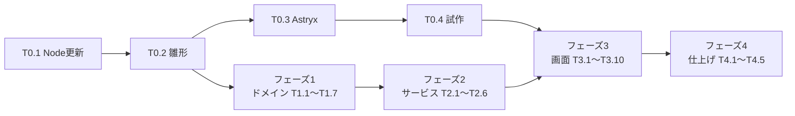

# 実装タスク: 筋トレ管理アプリ (Workout Tracker)

- ステータス: 承認済み（2026-11-18）
- 作成日: 2026-11-17
- 対応する文書: [requirements.md](./requirements.md)（承認済み） / [design.md](./design.md)（承認済み）

## 進め方のルール

1. タスクは**上から順に 1 つずつ**実行する。依存関係のないタスクも、原則として順番を守る。
2. 1 タスク = 1 コミットを基本とする。コミットメッセージの先頭にタスク ID を付ける（例: `T1.3: PR 判定を実装`）。
3. ドメイン層・サービス層は **テストを先に書く**（テスト → 実装 → リファクタリング）。
4. テスト名の先頭には要件 ID を付ける（例: `it('REQ-1.9: 回数が 0 のときセットを追加しない', ...)`）。
5. 「完了条件」をすべて満たしたら、チェックボックスを `[x]` にする。
6. 実装中に要件や設計の変更が必要になった場合は、**コードより先に requirements.md / design.md を更新し、承認を得る**。
7. 👤 マークのタスクは、ユーザーの作業または確認が必要。

---

## フェーズ 0: 準備

### [x] T0.1 👤 Node.js 22 LTS への更新

- 内容: 開発環境の Node.js を 18.20.4 から 22 LTS（22.13 以上）に更新する。
- 完了条件:
  - [x] `node -v` が `v22.13.0` 以上を表示する（nvm で v22.23.5 を導入、2026-11-18）
- 根拠: design.md 1.1 節, 9 章

### [x] T0.2 プロジェクトの雛形作成

- 内容: Vite + React 19 + TypeScript（strict）の雛形を作り、開発用ツールを設定する。
  - ESLint（`fetch` / `XMLHttpRequest` の使用を禁止するルールを含む）
  - Vitest + Testing Library + jsdom + fake-indexeddb
  - npm スクリプト: `dev` / `build` / `test` / `lint` / `typecheck`
  - `.nvmrc` に Node のバージョンを記載
  - design.md 2.2 節のディレクトリを作成
- 完了条件:
  - [x] `npm run build` / `npm test` / `npm run lint` / `npm run typecheck` がすべて成功する
  - [x] `fetch` を書くと `npm run lint` がエラーになる
- 要件: NFR-8, NFR-12

### [x] T0.3 Astryx の導入とアプリの枠組み

- 内容:
  - Astryx の CSS を読み込み、`<Theme theme={neutralTheme} mode="system">` で全体を囲む
  - `ja-JP` ロケールを設定する
  - Hash ルーターで design.md 6.1 節の全ルートを作る（中身は見出しだけの空ページ）
  - `AppShell` + 自作の下部タブ（幅 768px 未満）/ `SideNav`（768px 以上）のナビゲーションを作る
- 完了条件:
  - [x] 全ルートにナビゲーションから移動できる（`/workouts/:id` と `/templates/:id` は対象データができるまで URL 直接指定で確認。一覧からの導線は T3.x で作る）
  - [x] OS をダークモードにすると、アプリもダーク表示になる（Chromium で確認）
- 要件: NFR-2, NFR-9, NFR-11

### [x] T0.4 👤 試作によるリスクの確認

- 内容: 本実装の前に、design.md 9 章のリスクを試作で確認する。
  - 記録画面（6.3 節）の見た目だけの試作を作り、幅 360px で表示する
  - `Calendar` で特定の日に印を付けられるか確認する
- 完了条件:
  - [x] 👤 スマホの実機で（iPhone で確認、2026-11-18）、横スクロールなしで操作でき、ボタンが押しやすいことを確認する
  - [x] `Calendar` で日付に印を付けられるかどうかを確認し、結果を design.md の 6.4 節に追記する
  - [x] 問題が見つかった場合は（問題なし。カレンダーのみ自作方式に変更）、設計の変更案を出して承認を得る
  - [x] 試作のコードは削除する（本実装には残さない）
- 要件: NFR-2, NFR-3, REQ-3.6

---

## フェーズ 1: ドメイン層（純粋関数・テスト先行）

### [x] T1.1 型定義と入力チェック

- 内容: `domain/types.ts`（design.md 3.2 節）と `domain/validation.ts`（4.1 節）を作る。重量の kg ⇔ 0.1kg 整数の変換関数と、`nameKey` の生成関数も含める。
- 完了条件:
  - [x] 4.1 節の表の全ルールについて、正常値・境界値（0, 999.9, 1, 999, 50 文字, 51 文字など）・異常値のテストがある
  - [x] 全角・半角や大文字・小文字の違いだけの種目名が、重複と判定されるテストがある
- 要件: REQ-1.9, 1.11, 1.15, 1.17, 2.3, 2.4, 2.6, 4.2, 4.3, 4.4

### [x] T1.2 指標計算

- 内容: `domain/metrics.ts`（4.2 節）を作る。
- 完了条件:
  - [x] ボリューム、推定 1RM、ワークアウトごとの集計、種目ごとのグラフ用データ系列のテストがある
  - [x] 0kg のセットを含むケースのテストがある
- 要件: REQ-3.2, 3.8, 3.9, 3.10

### [x] T1.3 自己ベスト（PR）判定

- 内容: `domain/pr.ts`（4.3 節）を作る。
- 完了条件:
  - [x] 次のテストがある: 最初のセットは PR にならない / 重量のみ更新 / 推定 1RM のみ更新 / 同じ値は PR にならない / 0kg は PR にならない / 過去のセットを削除・編集すると判定が変わる / 同じ日に複数のワークアウトがあるときの順序
- 要件: REQ-3.13, 3.14

### [x] T1.4 セット入力の初期値

- 内容: `domain/setDefaults.ts`（4.4 節）を作る。前回記録（REQ-1.5）を取り出す関数も含める。
- 完了条件:
  - [x] 次のテストがある: 同じワークアウト内にセットがある / 過去の記録だけがある / どちらもない / 日付を過去に変更したワークアウトでは、それより前の記録を参照する
- 要件: REQ-1.5, 1.6, 1.7

### [x] T1.5 グラフ期間

- 内容: `domain/period.ts`（4.5 節）を作る。
- 完了条件:
  - [x] 4 つの期間それぞれのテストと、月末（例: 3 月 31 日の 1 か月前）・うるう年のテストがある
- 要件: REQ-3.11

### [x] T1.6 バックアップ形式の検証

- 内容: `domain/backupSchema.ts`（5.4 節の手順 2・3）を作る。
- 完了条件:
  - [x] 正しい形式のファイルが通るテストがある
  - [x] 不正な形式（JSON でない / `format` が違う / 未対応の `version` / 値が範囲外 / 存在しない ID への参照 / 種目名の重複 / 進行中のワークアウトが 2 件以上）を拒否するテストがある
- 要件: REQ-5.2, 5.5

### [x] T1.7 CSV 生成

- 内容: `domain/csv.ts`（5.4 節）を作る。
- 完了条件:
  - [x] 列の並び、行の並び順、BOM、`"`・`,`・改行を含む種目名のエスケープのテストがある
- 要件: REQ-5.7

---

## フェーズ 2: 永続化層・サービス層（統合テスト）

### [x] T2.1 DB スキーマと初期データ

- 内容: `db/` に Dexie のスキーマ（3.3 節）と初期種目（3.4 節）を作る。起動時に `navigator.storage.persist()` を呼ぶ。
- 完了条件:
  - [x] 新しい DB を作ると、胸〜腹の各部位に 3 種目以上が登録されるテストがある
  - [x] DB を開き直しても、初期種目が重複して登録されないテストがある
- 要件: REQ-2.1, NFR-7

### [x] T2.2 種目サービス

- 内容: `services/exerciseService.ts`（5.2 節）を作る。
- 完了条件:
  - [x] 追加・編集・重複時のエラー・未使用の種目の削除・使用中の種目のアーカイブ・復元のテストがある
  - [x] メニューだけで使われている種目もアーカイブされるテストがある
- 要件: REQ-2.2, 2.5, 2.6, 2.7, 2.8, 2.11

### [x] T2.3 ワークアウトサービス

- 内容: `services/workoutService.ts`（5.1 節）を作る。
- 完了条件:
  - [x] 5.1 節の表の全関数のテストがある（`startWorkout(templateId)` は T2.4）
  - [x] 進行中のワークアウトがあるときに開始すると、新しく作られず既存の ID が返るテストがある
  - [x] セットが 0 件で終了すると、破棄の確認が必要と返るテストがある
  - [x] 不正な値のセットや未来の日付は保存されないテストがある
- 要件: REQ-1.1, 1.4, 1.8, 1.10, 1.12, 1.13, 1.14, 1.16, 1.20, 1.21, 1.22, 1.24, 3.5

### [x] T2.4 メニューサービス

- 内容: `services/templateService.ts`（5.3 節）と、メニューからの開始処理（`startWorkout(templateId)`）を作る。
- 完了条件:
  - [x] 作成・編集・並べ替え・削除のテストがある
  - [x] メニューから開始すると種目が順番通りに追加され、目標セット数が引き継がれるテストがある
  - [x] アーカイブ済みの種目が除外され、その種目名が返るテストがある
  - [x] ワークアウトからメニューの下書きを作るテスト（セット数が 20 を超える場合を含む）がある
- 要件: REQ-4.1, 4.4, 4.5, 4.6, 4.7, 4.8, 4.9, 4.11

### [x] T2.5 バックアップサービス

- 内容: `services/backupService.ts`（5.4 節）を作る。
- 完了条件:
  - [x] エクスポートしたデータをインポートすると、元のデータと一致するテストがある
  - [x] 不正なファイルでは既存データが変わらないテストがある
  - [x] 書き込みの途中で例外を起こしても、既存データが元のまま残るテストがある
- 要件: REQ-5.1, 5.2, 5.4, 5.5, 5.6

### [x] T2.6 保存エラーの共通処理

- 内容: サービスの例外を受け取り、`Toast` で通知する仕組みを作る（5.5 節）。
- 完了条件:
  - [x] 保存に失敗すると「保存できませんでした」と表示されるテストがある
  - [x] 容量超過のときは、バックアップを促す文言が表示されるテストがある
- 要件: REQ-1.19

---

## フェーズ 3: 画面

### [x] T3.1 種目マスタ画面

- 内容: `#/exercises` を作る。部位ごとの一覧、追加・編集フォーム、削除（アーカイブされたことの通知を含む）、アーカイブ済みの一覧と復元。
- 完了条件:
  - [x] 入力エラーが入力欄の近くに表示されるテストがある
  - [x] 削除時に「削除しました」「アーカイブしました」のどちらかが通知されるテストがある
- 要件: REQ-2.2〜2.11

### [x] T3.2 ホーム画面と起動時の移動

- 内容: `#/` を作る。「ワークアウト開始」ボタン、メニューの一覧（選ぶと開始）、進行中のワークアウトがあれば「再開」を表示。起動時に進行中のワークアウトがあれば、記録画面へ移動する。
- 完了条件:
  - [x] 進行中のワークアウトがある状態で起動すると、記録画面が表示されるテストがある
  - [x] メニューから開始したときに除外された種目名が通知されるテストがある
- 要件: REQ-1.1, 1.23, 1.24, 4.8, 4.9

### [x] T3.3 記録画面: 種目の追加と削除

- 内容: `#/workouts/:id` に、種目を選ぶ `BottomSheet`（部位で絞り込める）と、ワークアウトからの種目の削除を作る。
- 完了条件:
  - [x] 部位を選ぶと、その部位の有効な種目だけが表示されるテストがある
  - [x] アーカイブ済みの種目が選択肢に出ないテストがある
- 要件: REQ-1.2, 1.3, 1.4, 1.13, 2.9

### [x] T3.4 記録画面: セットの記録

- 内容: 前回記録の表示、初期値入りの入力欄（± ボタンは重量 1kg・回数 1）、「+ セット」ボタン、セットの編集・削除、PR の印、目標セット数の表示を作る。
- 完了条件:
  - [x] 初期値がある状態で「+ セット」を 1 回押すとセットが追加されるテストがある
  - [x] 不正な値ではエラーが表示され、セットが追加されないテストがある
  - [x] PR のセットに印が付くテストがある
  - [x] 「2 / 3 セット」の形で目標セット数が表示されるテストがある
- 要件: REQ-1.5〜1.12, 1.18, 3.13, 3.14, 4.10, NFR-4

### [x] T3.5 記録画面: メモ・日付・終了

- 内容: メモ欄（500 文字の上限と文字数表示）、日付の変更、「ワークアウト終了」と破棄の確認、完了済みワークアウトの編集表示を作る。
- 完了条件:
  - [x] 未来の日付が選べない、またはエラーになるテストがある
  - [x] セットが 0 件のまま終了すると、破棄の確認が表示されるテストがある
  - [x] 完了済みのワークアウトでは「終了」ボタンが表示されず、編集はできるテストがある
- 要件: REQ-1.14〜1.18, 1.20〜1.22, 1.25

### [x] T3.6 履歴一覧

- 内容: `#/history` の一覧表示（30 件ずつ読み込み）、詳細への移動、ワークアウトの削除（確認あり）、「メニューにする」操作を作る。
- 完了条件:
  - [x] 同じ日付の複数ワークアウトを含めて、並び順が正しいテストがある
  - [x] 各項目に日付・種目名・総セット数・総ボリュームが表示されるテストがある
  - [x] アーカイブ済みの種目も名前付きで表示されるテストがある
  - [x] 削除時に確認が表示されるテストがある
- 要件: REQ-3.1〜3.5, 2.10, 4.11

### [x] T3.7 履歴カレンダー

- 内容: 履歴画面に一覧 / カレンダーの切り替えを付け、カレンダーを作る（T0.4 の結果に従い、Astryx の `Calendar` か自作のグリッドを使う）。
- 完了条件:
  - [x] ワークアウトがある日に印が付くテストがある
  - [x] 日付を選ぶと、その日の全ワークアウトが表示されるテストがある
- 要件: REQ-3.6, 3.7

### [ ] T3.8 👤 グラフ画面（実装済み・ライト/ダークの目視確認待ち）

- 内容: `#/progress` に、種目の選択、期間の切り替え、3 つの折れ線グラフ、記録がないときの表示を作る。
- 完了条件:
  - [x] 種目を選ぶと 3 つのグラフが表示されるテストがある
  - [x] 期間内に記録がないと「記録がありません」と表示されるテストがある
  - [ ] 👤 ライト / ダーク両方で、グラフの線と文字が読めることを確認する
- 要件: REQ-3.8〜3.12, NFR-10

### [x] T3.9 メニュー画面

- 内容: `#/templates` の一覧・削除、`#/templates/new`・`#/templates/:id` の作成・編集（↑↓ ボタンでの並べ替え、目標セット数）、履歴から作った下書きの受け取りを作る。
- 完了条件:
  - [x] ↑↓ ボタンで種目の順番が入れ替わるテストがある
  - [x] 名前が空、または種目が 0 件では保存できないテストがある
- 要件: REQ-4.1〜4.7, 4.11

### [x] T3.10 設定画面（データ管理）

- 内容: `#/settings` に JSON エクスポート、JSON インポート（チェック → 確認 → 置き換え）、CSV エクスポート、種目マスタへのリンクを作る。
- 完了条件:
  - [x] 不正なファイルでは確認を出さずにエラーが表示されるテストがある
  - [x] 正しいファイルでは確認が表示され、承認後にデータが置き換わるテストがある
- 要件: REQ-5.1〜5.7

---

## フェーズ 4: 非機能要件・仕上げ

### [ ] T4.1 👤 PWA（オフライン対応）（実装済み・実機の機内モード確認待ち）

- 内容: vite-plugin-pwa を設定し、全アセットをプリキャッシュする。アプリのアイコンとマニフェストを用意する。
- 完了条件:
  - [ ] 👤 一度開いた後、機内モードで再読み込みしても全機能が使える（Chromium のオフライン状態では確認済み: 再読み込み、記録、全 6 画面の移動。実機での確認が残っている）
- 要件: NFR-6

### [x] T4.2 性能の確認

- 内容: 500 ワークアウト / 15,000 セットのダミーデータを作るスクリプトを用意し、各画面の表示時間を測る。
- 完了条件:
  - [x] 全画面が 1 秒以内に表示される（測定結果をこのタスクに追記する）（CPU 制限なしで達成。CPU を 4 倍遅くした条件で 2 項目が 1 秒前後だが、対象の実機（iPhone）は十分速いため許容と判断、2026-11-21）
  - [x] 1 秒を超える画面があれば改善する
- 要件: NFR-5

**測定方法**: `node scripts/measure-performance.cjs seed`（ダミーデータの投入）→ `node scripts/measure-performance.cjs measure`（本番ビルドを Chromium・幅 360px で測定。3 回の中央値）。データは `src/test/dummyData.ts` が生成する（シード固定で再現できる）。操作の開始から、画面の内容が表示されるまでの時間。

**測定結果（2026-11-20、この環境の Chromium。単位 ms）**

| 画面 | CPU 制限なし | CPU を 4 倍遅く（スマホの低め想定） |
| --- | ---: | ---: |
| ホーム | 37 | 120 |
| 履歴一覧（30 件） | 237 | 467 |
| 履歴一覧「さらに表示」 | 313 | 1254 ✗ |
| 履歴カレンダー | 78 | 246 |
| 記録画面（最新のワークアウト） | 268 | 764 |
| グラフ（種目を選ぶ → 3 グラフ表示） | 365 | 843 |
| グラフ（期間を切り替え） | 136 | 448 |
| メニュー一覧 / 編集 | 108 / 73 | 261 / 226 |
| 設定 / 種目マスタ | 17 / 16 | 90 / 86 |
| JSON エクスポート（全データ） | 206 | 436 |
| 起動（再読み込み → ホーム） | 150 | 489 |
| 起動（再読み込み → 履歴） | 355 | 1200 ✗ |

- **CPU 制限なしでは、全画面が 1 秒以内**（最も遅いのは起動 → 履歴の 0.36 秒）。
- **CPU を 4 倍遅くした条件では、2 項目が 1 秒前後〜超過**（「さらに表示」約 1.1〜1.3 秒、起動 → 履歴 約 0.9〜1.5 秒。実行ごとのばらつきが大きい）。

**行った改善（改善前の CPU×4: グラフ 1518 / 起動 → 履歴 1074）**

1. グラフ画面: 全セットではなく、選んだ種目のセットだけを `exerciseId` のインデックスから読む。
2. 履歴画面: 全ワークアウトの集計をやめ、表示する分だけを `workoutId` のインデックスから読む。
3. グラフ画面（Recharts、約 410kB）を遅延読み込みにして、起動時に読む JavaScript を約 1.87MB から約 1.30MB に減らした。
4. 履歴の項目に `content-visibility: auto` を指定し、画面外の項目の描画を省く（CPU×4 の 30 件表示: 878 → 約 500）。

**試して採用しなかったもの**: 履歴の行の再描画を省く `memo`（効果が測定のばらつきの範囲内で確認できなかったため）。

**残る課題**: 履歴の「さらに表示」と起動 → 履歴は、Astryx のカードの描画（ブラウザ内部のスタイル計算・レイアウト）が支配的。さらに速くするには、履歴の項目を軽い部品に置き換える、または追加読み込みの件数を減らす必要がある。

### [x] T4.3 アクセシビリティの確認

- 内容: Lighthouse のアクセシビリティ監査をライト / ダーク両方で実行し、指摘を直す。主要ボタンのタップ領域を確認する。
- 完了条件:
  - [x] コントラストに関する指摘が 0 件
  - [x] 主要ボタンのタップ領域が 44×44px 以上
- 要件: NFR-3, NFR-10

**確認結果（2026-11-21）**

- **Lighthouse 13.6.0**（アクセシビリティのみ。モバイル 360px）を、ホーム・履歴・グラフ・メニュー一覧・メニュー作成・設定・種目マスタの 7 画面 × ライト / ダークで実行: **全 14 回が 100 点、`color-contrast` は全回合格**。
- **axe-core 4.14.1**（WCAG 2.0/2.1 A・AA とベストプラクティス）を、データ入りの 9 画面（ホーム、履歴の一覧とカレンダー、記録、グラフ、メニュー一覧と編集、設定、種目マスタ）× ライト / ダーク × 幅 360px / 1100px で実行: **指摘 0 件**。
- **タップ領域**: 全画面のボタン・リンク・ラジオ・入力欄（見た目の枠）を測定し、**44×44px 未満は 0 件**。ただし、見えないスキップリンクと、カード全体をリンクにするための 1×1px の透明なアンカーは対象外とした。
- スクリーンショットで、グラフ・記録画面・カレンダー・ホームが、ライト / ダークとも崩れず読めることを確認した（T3.8 の 👤 確認の参考。最終確認は実機で行う）。

**直した内容**

1. タップ領域: ボタン・ラジオ・コンボボックス・入力欄・サイドナビに最小 44px を指定した（`globals.css`。Astryx の標準は 24〜36px だった）。メニュー一覧と設定のリンクも 44px にした。
2. 色: Astryx に存在しないトークン名（`--astryx-color-*`）を使っていたため、固定のフォールバック色になっていた。実在する `--color-*` に直し、ライト / ダークに追従するようにした（グラフの線・軸・目盛り、カレンダーの印と月外の日付など）。
3. カレンダーの月外の日付: 透明度（0.4）で薄くしていたためコントラスト不足（2.84:1）だった。文字色で弱めるように変更。
4. 名前の不一致（WCAG 2.5.3）: カレンダーの日付ボタンの読み上げ名を「10日 2026-11-10（ワークアウトあり）」にし、表示の「10」を含めた。種目を外すボタンの表示を「削除」から「外す」に変更。
5. 見出しの階層: 空の状態の見出しが h1 の次に h3 になっていたため、h2 にした（Lighthouse の `heading-order`）。
6. 記録画面の「完了」バッジが狭い画面で「完…」と欠けていたため、縮まないようにした。

### [x] T4.4 要件とテストの対応チェック

- 内容: requirements.md の全要件 ID について、テストが存在するかを一覧にするスクリプトを作る（テスト名の先頭の要件 ID を集計する）。
- 完了条件:
  - [x] テストがない要件 ID が、手動確認の対象（NFR-1, 2, 6 など）だけになっている
- 要件: NFR-12

**使い方**: `npm run check:requirements`（`-- --verbose` で全要件の一覧）。テストがなく、手動確認の対象にも登録されていない要件があると、終了コード 1 で失敗する。`requirements.md` にない ID を使うテスト、スキップ中のテストも検出する。`REQ-5.3, 5.4:` や `REQ-3.8〜3.10:` の書き方に対応。

**結果（2026-11-21）**: 要件 80 件のうち **71 件（89%）にテストがある**。残る 9 件は、次のとおり自動テストでは確認せず、別の方法で確認する（確認方法はスクリプトの `MANUAL` に記載）。

| 要件 | 確認方法 |
| --- | --- |
| NFR-1 ブラウザ | 主要 4 ブラウザでの手動確認（T4.5） |
| NFR-2 幅 360px | 実機での手動確認（T0.4 済み、T4.5） |
| NFR-3 タップ領域 | 全画面の寸法を測定（T4.3 済み） |
| NFR-5 性能 | 本番ビルドでの計測 `scripts/measure-performance.cjs`（T4.2 済み） |
| NFR-6 オフライン | Service Worker のオフライン確認（T4.1、T4.5） |
| NFR-8 外部通信なし | ESLint で `fetch` 等を禁止（`npm run lint`） |
| NFR-9 ダークテーマ | OS をダークにして確認（T3.8、T4.5） |
| NFR-10 コントラスト | Lighthouse / axe-core の監査（T4.3 済み） |
| NFR-12 テストの対応 | このスクリプト自身 |

**この作業で見つかった穴と対応**

- NFR-11（UI を日本語で表示）にテストがなかったため、`src/app/language.test.tsx` を追加した。ページの言語設定、全 7 画面の見出しと操作できる要素の名前、Astryx 側の文言（日付入力・種目を選ぶシート）が日本語であることを確認する。英語の名前を混ぜると失敗することも確認済み。
- ダミーデータ生成のテストが `NFR-5:` で始まり、性能の検証と誤解されるため、名前を「ダミーデータ: …」に改めた。

### [ ] T4.5 👤 最終の手動確認

- 内容: 次のチェックリストを実施する。
  - [ ] Chrome / Safari / Firefox / Edge（PC）で主な操作ができる
  - [ ] iPhone の Safari、Android の Chrome で主な操作ができる
  - [ ] 幅 360px で横スクロールが出ない
  - [ ] オフラインで動く
  - [ ] JSON エクスポート → データ削除 → インポートで元に戻る
- 要件: NFR-1, NFR-2, NFR-6

---

## タスクの依存関係

